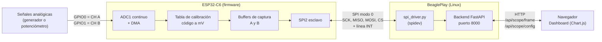
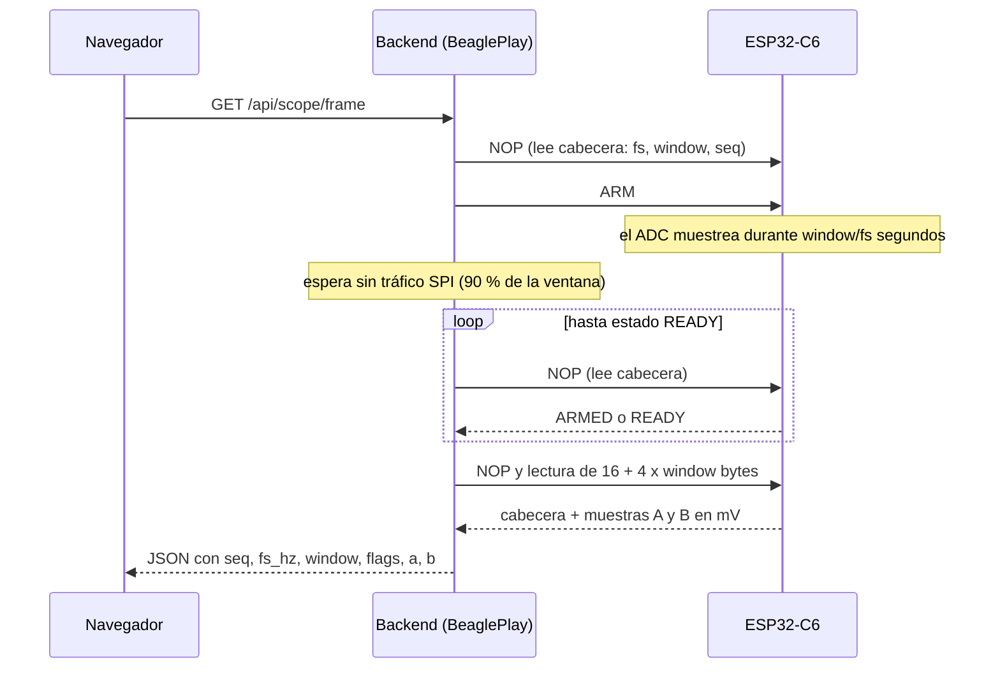
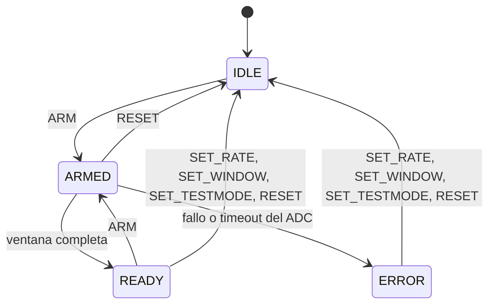
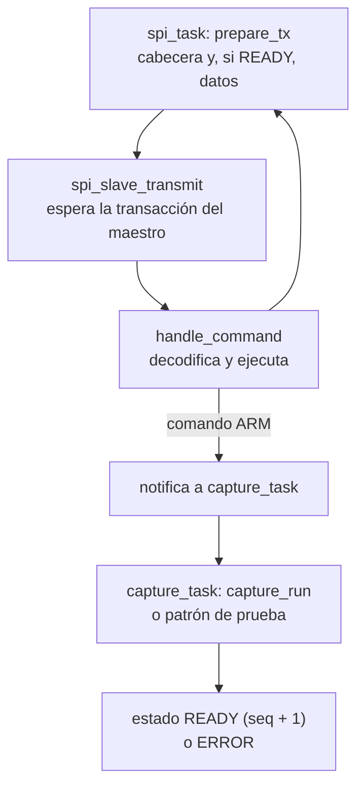

# 01. Descripción general

## 1. Objetivo

Construir un sistema híbrido **microprocesador + microcontrolador** que capture **dos señales analógicas** en ventanas de adquisición, como un osciloscopio, y las muestre en un **dashboard web** servido por el SBC a través de la red.

El proyecto explora las interfaces de entrada/salida: ADC del microcontrolador, **SPI** entre las dos placas y red/HTTP en el SBC.

## 2. Arquitectura

| Elemento | Hardware | Papel |
|---|---|---|
| Adquisición | **ESP32-C6-DevKitC-1** | Muestrea 2 canales con el ADC1 en modo continuo (DMA), calibra a milivoltios y entrega la ventana por SPI. Es **esclavo** SPI |
| Procesamiento y red | **BeaglePlay** (SoC TI AM625, Linux) | **Maestro** SPI. Ejecuta el backend, pide capturas, cambia el preset y sirve el dashboard por HTTP |
| Interfaz | Navegador (cualquier equipo de la red) | Dashboard con gráfica, estadísticas y controles |

Conexión física: ver [03-hardware-y-conexiones.md](03-hardware-y-conexiones.md).

## 3. Flujo de una captura

El maestro **inicia** cada captura (el esclavo SPI no puede enviar por iniciativa propia). El esclavo captura una ventana, la deja lista y el maestro la lee.

Cambio de frecuencia de muestreo: el dashboard envía `POST /api/scope/config` con `{"rate_idx": N}` y el backend manda `SET_RATE` por SPI.

## 4. Máquina de estados del ESP32-C6

Los comandos de configuración (`SET_RATE`, `SET_WINDOW`, `SET_TESTMODE`) durante `ARMED` abortan la captura y llevan el estado a `IDLE`; `ARM` con una captura en curso se rechaza (flag `comando rechazado`).

## 5. Tareas del firmware

Detalle en [05-firmware-esp32c6.md](05-firmware-esp32c6.md).

## 6. Decisiones de diseño

| Decisión | Motivo |
|---|---|
| SBC = **BeaglePlay** en el socket **mikroBUS**, SBC maestro | Definido por el equipo; el maestro controla el ritmo de lectura |
| **ESP-IDF 5.4.1** (C) en el ESP32-C6 | Soporte completo del ADC continuo con DMA y del SPI esclavo con DMA |
| **ADC1 continuo** con temporización por hardware | Garantiza frecuencia de muestreo constante, sin depender del software |
| Captura **bajo demanda** (`ARM`) | El dashboard refresca a ≤ 1 Hz, no se necesita transmitir en continuo |
| Cabecera de estado en **toda** respuesta | El esclavo prepara la respuesta antes de la transacción; el efecto de un comando se ve en la transacción siguiente |
| Línea **INT** (handshake) | Permite al maestro saber cuándo el esclavo está listo (hoy el backend usa pausas y reintentos) |
| Muestras en **mV calibrados** (protocolo v2) | El ADC sin calibrar leía hasta 0,7 V de menos (ver [08](08-calibracion-adc.md)) |
| Backend **FastAPI** que también sirve el dashboard | Un solo origen y puerto, sin problemas de CORS (el enunciado pide apache o nginx: hay un `nginx.conf` sin probar, ver [13](13-pendientes-y-riesgos.md)) |
| Chart.js **local** (`dashboard/vendor`) | La BeaglePlay puede no tener Internet |

## 7. Alcance actual

Implementado y probado en hardware: enlace SPI a 2 MHz, modo de prueba, cambio de presets, captura real del ADC, dashboard con API real, calibración de eFuse (compila; pendiente medirla). Pendiente: servidor apache/nginx, verificación de frecuencia de muestreo con instrumentos, 40 kSa/s estable, tasa máxima de SPI, video y declaraciones. Ver [10](10-matriz-de-verificacion.md) y [13](13-pendientes-y-riesgos.md).
