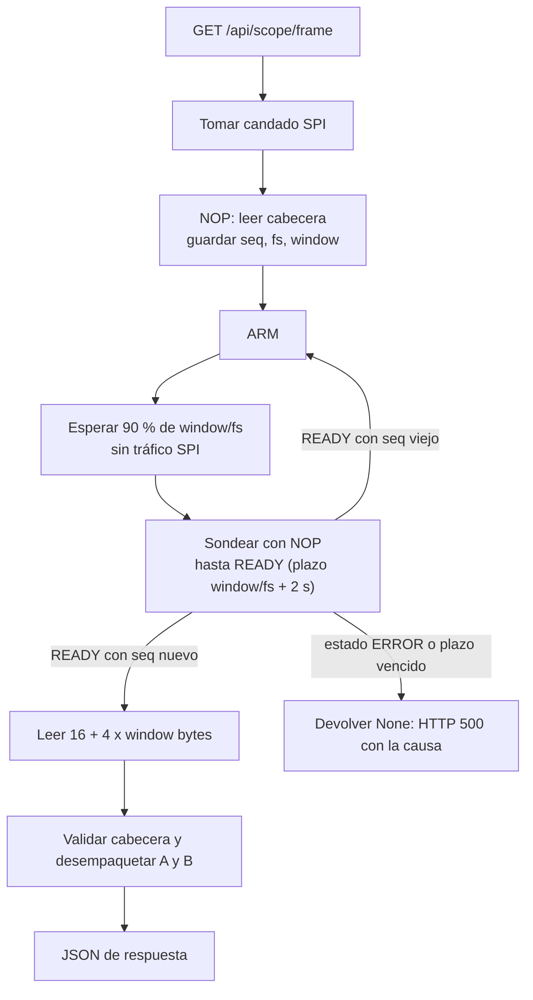

# 06. Backend en la BeaglePlay

Código en [`beagleplay/backend/`](../../beagleplay/backend). Base escrita por **Juan Camilo Giraldo** (FastAPI, `spi_driver.py`, scripts de prueba); robustecida por David Henao Rojas (reintentos, candado, tiempos de espera, diagnóstico). Documentación propia del módulo: [`beagleplay/backend/README.md`](../../beagleplay/backend/README.md).

## 1. Componentes

| Archivo | Función |
|---|---|
| `main.py` | Servidor FastAPI. Rutas `/api/scope/frame` y `/api/scope/config`; sirve el dashboard como archivos estáticos desde `/` |
| `spi_driver.py` | Clase `SPIDriver`: abre `spidev`, construye comandos con checksum, valida cabeceras y ejecuta la secuencia de captura |
| `prueba_directa_spi.py` | Diagnóstico mínimo: envía 5 NOP y muestra la cabecera |
| `test_spi.py` | Prueba con modo de prueba (rampas) |
| `diagnostico_captura.py` | Imprime paso a paso `ARM`, sondeos y lectura; verifica las rampas. Uso: `sudo python3 diagnostico_captura.py [velocidad_hz] [rate_idx]` |

## 2. API

| Método y ruta | Cuerpo / respuesta |
|---|---|
| `GET /api/scope/frame` | `200`: `{seq, rate_idx, fs_hz, window, flags, retries, a:[mV], b:[mV]}`. `500` con `detail` = causa del fallo SPI |
| `POST /api/scope/config` | Cuerpo `{"rate_idx": 0..3}`. Envía `SET_RATE`. `400` si el índice es inválido |

`flags` es el de la cabecera del protocolo, con el bit2 enmascarado (ver sección 4). `retries` es el número de transacciones SPI inválidas que hubo que repetir en esa captura.

## 3. Configuración

| Parámetro | Valor | Cómo cambiarlo |
|---|---|---|
| Dispositivo SPI | `/dev/spidev0.0` (bus 0, dispositivo 0) | `SPIDriver(bus, device)` en `main.py` |
| Velocidad SPI | **2 MHz** por defecto (antes 100 kHz) | Variable de entorno `SPI_SPEED_HZ` |
| Modo de datos | `USE_MOCK = False` (SPI real) | Editar `main.py`; `True` genera senoidales simuladas |
| Puerto HTTP | 8000 | Argumento `--port` de uvicorn |

Ejecución **a mano** (para pruebas; la velocidad que se usó para las pruebas buenas es 2 MHz). Si el servicio automático está instalado, páralo antes (`sudo systemctl stop osciloscopio-backend`) para liberar el puerto 8000:

```bash
cd beagleplay/backend
SPI_SPEED_HZ=2000000 sudo -E python3 -m uvicorn main:app --host 127.0.0.1 --port 8000
```

Se usa `sudo -E` para que `spidev` tenga permiso y se conserve la variable de entorno. Dependencias: `fastapi`, `uvicorn`, `pydantic`, `spidev`. Con `--host 127.0.0.1` solo nginx (puerto 80) puede llegar al backend; para abrir el puerto 8000 directamente desde otro equipo, usar `--host 0.0.0.0`.

### Arranque automático con systemd

Para que al alimentar la placa todo funcione solo (nginx ya arranca solo; el backend no), se instala el backend como servicio:

```bash
sudo bash ~/Osciloscopio-Linux-Embebido/beagleplay/instalar_servicio.sh
```

El script ([`beagleplay/instalar_servicio.sh`](../../beagleplay/instalar_servicio.sh)) comprueba los paquetes de Python, el `/dev/spidev0.0` y que el puerto 8000 esté libre; genera la unidad `/etc/systemd/system/osciloscopio-backend.service` a partir de la plantilla [`beagleplay/systemd/osciloscopio-backend.service`](../../beagleplay/systemd/osciloscopio-backend.service) (sustituye la ruta del repositorio, el usuario y el Python de la placa), la habilita y la inicia. Se puede ejecutar de nuevo sin problema.

| Decisión de la unidad | Motivo |
|---|---|
| `User=root` | Necesita abrir `/dev/spidev0.0`, igual que con `sudo` a mano |
| `Environment=PYTHONUSERBASE=<home>/.local` | Los paquetes se instalaron con `pip3 install --break-system-packages` como usuario normal, es decir, en `~/.local`; root no los vería sin esto |
| `--host 127.0.0.1 --port 8000` | Solo nginx llega al backend |
| `Restart=always`, `RestartSec=3` | Si el backend se cae, vuelve a levantarse |
| `SPI_SPEED_HZ=2000000` | La velocidad que funcionó |

Con el arranque automático hubo que corregir el driver: antes, si `/dev/spidev0.0` no existía en el instante de arrancar, `open()` fallaba una vez y el SPI quedaba cerrado hasta reiniciar el proceso. Ahora `spi_driver.py` reintenta abrirlo (máximo una vez por segundo) y también se recupera si `xfer2` lanza un `OSError`. Se verificó con un `spidev` simulado en el PC (arranque sin dispositivo, aparición posterior, error a mitad de captura); **en la placa real está pendiente**.

Comandos útiles:

```bash
systemctl is-active osciloscopio-backend     # active
systemctl is-enabled osciloscopio-backend    # enabled (arranca con la placa)
sudo journalctl -u osciloscopio-backend -f   # registro en vivo; aquí salen los [ERROR REST]
sudo systemctl restart osciloscopio-backend  # tras un git pull
sudo systemctl disable --now osciloscopio-backend   # desinstalar el arranque automático
```

Al arrancar, el backend puede tardar unos segundos en responder; hasta entonces nginx contesta `502`. El ESP32-C6 se alimenta por su propio USB: si se enciende después de la BeaglePlay, las primeras capturas fallan con `HTTP 500` hasta que el esclavo SPI está listo, y el dashboard sigue reintentando en cada ciclo de refresco.

## 4. Secuencia de captura (`capture_frame`)



Detalles de `spi_driver.py` que no estaban en la versión inicial:

- **Reintentos** (`_xfer_valid`, hasta 12 por transacción, 5 ms entre intentos): el esclavo pierde parte de las transacciones ([09](09-pruebas-y-resultados.md)). Un reintento es seguro porque un comando corrupto se descarta por checksum en el firmware.
- **Candado** (`threading.RLock`): los endpoints corren en hilos distintos; sin candado, un `POST config` podía mezclarse con un `GET frame` en pleno SPI.
- **Plazo calculado**: `window/fs + 2 s`. La versión inicial esperaba ≈ 0,35 s, insuficiente a 100 Sa/s (ventana de 2,56 s).
- **Espera sin tráfico SPI** durante el muestreo (90 % de la ventana): mitigación contra ruido en el ADC cuyo origen no está confirmado.
- **Detección de captura vieja**: si el `ARM` se perdió, el esclavo sigue en `READY` con la captura anterior; se compara `seq` y se reenvía `ARM` (hasta 4 veces).
- **Ventana desde la cabecera**: ya no está fija en 256; se usa `window` del esclavo.
- **`set_rate`** valida con una transacción adicional, porque el efecto de un comando aparece en la respuesta siguiente.
- **Flags**: el bit2 (checksum de comando) se enmascara, porque queda pegado tras una transacción corrupta ya recuperada. Se informa en su lugar `retries`.
- **Diagnóstico**: `last_error` guarda la causa del fallo y se imprime como `[ERROR REST] ...` y en el `detail` del HTTP 500. Causas posibles: `sin cabecera valida antes de ARM`, `ARM sin respuesta valida`, `sondeo sin cabecera valida`, `el ESP32 reporta ERROR (fallo del ADC)`, `timeout esperando READY`, `lectura de datos invalida`.

## 5. Estado y limitaciones

- ✅ Lectura de cabeceras válidas, captura en modo de prueba y captura real a 100 y 1.000 Sa/s sin problemas, y a 10.000 Sa/s con errores esporádicos (mensajes no registrados), a través del dashboard.
- ❌ A **40.000 Sa/s** se observó un error constante; el mensaje exacto no se registró ([13](13-pendientes-y-riesgos.md)).
- ⚠️ Con reintentos altos (24 a 39 por trama a 1 y 10 kSa/s) la latencia por captura sube; no se ha medido.
- ⚠️ La línea INT no se usa; todo se resuelve con pausas y reintentos.
- 🟡 **nginx**: el enunciado exige apache o nginx. El equipo del SBC añadió [`beagleplay/nginx.conf`](../../beagleplay/nginx.conf) (2026-11-04): `location /` sirve `dashboard/` desde `/home/camilo/Osciloscopio-Linux-Embebido/dashboard` y `location /api/` hace `proxy_pass` a `http://127.0.0.1:8000`, con el puerto 80. **Verificado en la BeaglePlay el 2026-11-05:**
  - `sudo nginx -t` → `syntax is ok` / `test is successful`.
  - `systemctl status nginx` → `enabled` y `active (running)` (desde las 00:58:38 UTC, 16 h).
  - `curl -i http://127.0.0.1/` → `HTTP/1.1 200 OK`, `Server: nginx`, devuelve el `index.html` del dashboard. Como nginx lo lee de `/home/camilo/...` sin error, el problema de permisos (403) que se temía no existe.
  - En P-16, `curl -i http://127.0.0.1/api/scope/frame` → `502 Bad Gateway` porque el backend estaba apagado.
  - En la repetición P-18, `systemctl is-active/is-enabled osciloscopio-backend` → `active`/`enabled` y `curl -i http://127.0.0.1/api/scope/frame` → `200 OK`, JSON con una trama de 256 muestras, `flags: 0` y `retries: 0`. Esto confirma el proxy y una captura completa en esa ejecución.

  El 502 (HTML de nginx) se distingue de un fallo SPI (HTTP 500 en JSON de FastAPI, con `detail: "SPI: ..."`). Para el flujo completo, el backend se ejecuta en `127.0.0.1:8000` y se abre `http://<IP>/`. El 2026-11-04 y el 2026-11-05 el equipo ya usó el dashboard por el puerto 80 con datos reales (en el log de uvicorn las peticiones aparecen como `192.168.7.1:0` con `HTTP/1.0`, firma del proxy). P-19 confirma que, tras reiniciar la placa, el backend arrancó sin intervención y el dashboard permitió medir. Pendiente: documentar la instalación de nginx (paquete y cómo se copió la configuración) y realizar una prueba explícita de concurrencia del backend.
- ⏳ Falta documentar cómo se habilitó `/dev/spidev0.0` (según el equipo ya venía habilitado en la imagen).
- Las pruebas en la BeaglePlay las ejecutó el equipo del SBC (Juan Camilo). Las correcciones de reintentos y tiempos se verificaron primero con un esclavo SPI simulado en el PC y después en la placa real.
