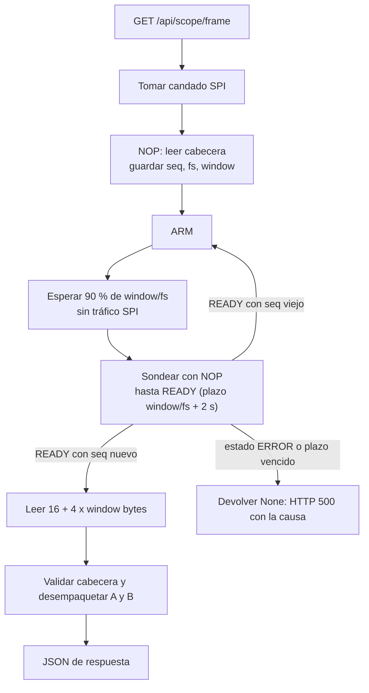

# 06. Backend en la BeaglePlay

Código en [`beagleplay/backend/`](../../beagleplay/backend). Base escrita por **Juan Camilo Giraldo** (FastAPI, `spi_driver.py`, scripts de prueba); robustecida por David Henao Rojas (reintentos, candado, tiempos de espera, diagnóstico). Documentación propia del módulo: [`beagleplay/backend/README.md`](../../beagleplay/backend/README.md).

## 1. Componentes

| Archivo | Función |
|---|---|
| `main.py` | Servidor FastAPI. Rutas `/api/scope/frame` y `/api/scope/config`; sirve el dashboard como archivos estáticos desde `/` |
| `spi_driver.py` | Clase `SPIDriver`: abre `spidev`, construye comandos con checksum, valida cabeceras y ejecuta la secuencia de captura |
| `prueba_directa_spi.py` | Diagnóstico mínimo: envía 5 NOP y muestra la cabecera |
| `test_spi.py` | Prueba con modo de prueba (rampas) |
| `diagnostico_captura.py` | Imprime paso a paso `ARM`, sondeos y lectura; verifica las rampas. Uso: `sudo python3 diagnostico_captura.py [velocidad_hz] [rate_idx]` |

## 2. API

| Método y ruta | Cuerpo / respuesta |
|---|---|
| `GET /api/scope/frame` | `200`: `{seq, rate_idx, fs_hz, window, flags, retries, a:[mV], b:[mV]}`. `500` con `detail` = causa del fallo SPI |
| `POST /api/scope/config` | Cuerpo `{"rate_idx": 0..3}`. Envía `SET_RATE`. `400` si el índice es inválido |

`flags` es el de la cabecera del protocolo, con el bit2 enmascarado (ver sección 4). `retries` es el número de transacciones SPI inválidas que hubo que repetir en esa captura.

## 3. Configuración

| Parámetro | Valor | Cómo cambiarlo |
|---|---|---|
| Dispositivo SPI | `/dev/spidev0.0` (bus 0, dispositivo 0) | `SPIDriver(bus, device)` en `main.py` |
| Velocidad SPI | **100 kHz** por defecto | Variable de entorno `SPI_SPEED_HZ` |
| Modo de datos | `USE_MOCK = False` (SPI real) | Editar `main.py`; `True` genera senoidales simuladas |
| Puerto HTTP | 8000 | Argumento `--port` de uvicorn |

Ejecución (la velocidad que se usó para las pruebas buenas es 2 MHz):

```bash
cd beagleplay/backend
SPI_SPEED_HZ=2000000 sudo -E python3 -m uvicorn main:app --host 0.0.0.0 --port 8000
```

Se usa `sudo -E` para que `spidev` tenga permiso y se conserve la variable de entorno. Dependencias: `fastapi`, `uvicorn`, `pydantic`, `spidev`.

## 4. Secuencia de captura (`capture_frame`)



Detalles de `spi_driver.py` que no estaban en la versión inicial:

- **Reintentos** (`_xfer_valid`, hasta 12 por transacción, 5 ms entre intentos): el esclavo pierde parte de las transacciones ([09](09-pruebas-y-resultados.md)). Un reintento es seguro porque un comando corrupto se descarta por checksum en el firmware.
- **Candado** (`threading.RLock`): los endpoints corren en hilos distintos; sin candado, un `POST config` podía mezclarse con un `GET frame` en pleno SPI.
- **Plazo calculado**: `window/fs + 2 s`. La versión inicial esperaba ≈ 0,35 s, insuficiente a 100 Sa/s (ventana de 2,56 s).
- **Espera sin tráfico SPI** durante el muestreo (90 % de la ventana): mitigación contra ruido en el ADC cuyo origen no está confirmado.
- **Detección de captura vieja**: si el `ARM` se perdió, el esclavo sigue en `READY` con la captura anterior; se compara `seq` y se reenvía `ARM` (hasta 4 veces).
- **Ventana desde la cabecera**: ya no está fija en 256; se usa `window` del esclavo.
- **`set_rate`** valida con una transacción adicional, porque el efecto de un comando aparece en la respuesta siguiente.
- **Flags**: el bit2 (checksum de comando) se enmascara, porque queda pegado tras una transacción corrupta ya recuperada. Se informa en su lugar `retries`.
- **Diagnóstico**: `last_error` guarda la causa del fallo y se imprime como `[ERROR REST] ...` y en el `detail` del HTTP 500. Causas posibles: `sin cabecera valida antes de ARM`, `ARM sin respuesta valida`, `sondeo sin cabecera valida`, `el ESP32 reporta ERROR (fallo del ADC)`, `timeout esperando READY`, `lectura de datos invalida`.

## 5. Estado y limitaciones

- ✅ Lectura de cabeceras válidas, captura en modo de prueba y captura real a 100 y 1.000 Sa/s sin problemas, y a 10.000 Sa/s con errores esporádicos (mensajes no registrados), a través del dashboard.
- ❌ A **40.000 Sa/s** se observó un error constante; el mensaje exacto no se registró ([13](13-pendientes-y-riesgos.md)).
- ⚠️ Con reintentos altos (24 a 39 por trama a 1 y 10 kSa/s) la latencia por captura sube; no se ha medido.
- ⚠️ La línea INT no se usa; todo se resuelve con pausas y reintentos.
- ⏳ **Falta apache o nginx**: el enunciado lo exige para servir el dashboard. Hoy lo hace uvicorn. Opción: nginx sirve `dashboard/` y hace `proxy_pass /api/` hacia `127.0.0.1:8000`.
- ⏳ Falta documentar cómo se habilitó `/dev/spidev0.0` y arrancar el backend como servicio (`systemd`).
- Las pruebas en la BeaglePlay las ejecutó el equipo del SBC (Juan Camilo). Las correcciones de reintentos y tiempos se verificaron primero con un esclavo SPI simulado en el PC y después en la placa real.
