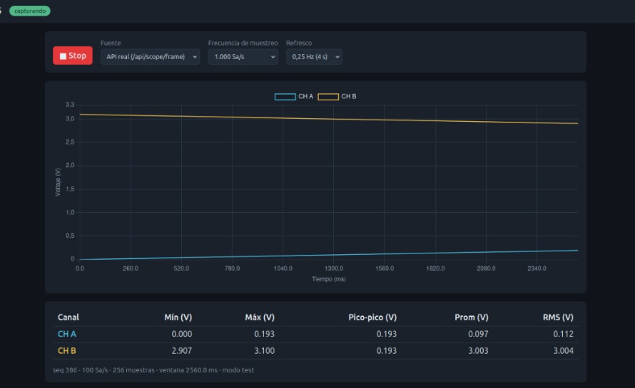
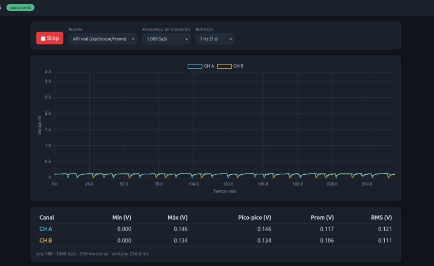
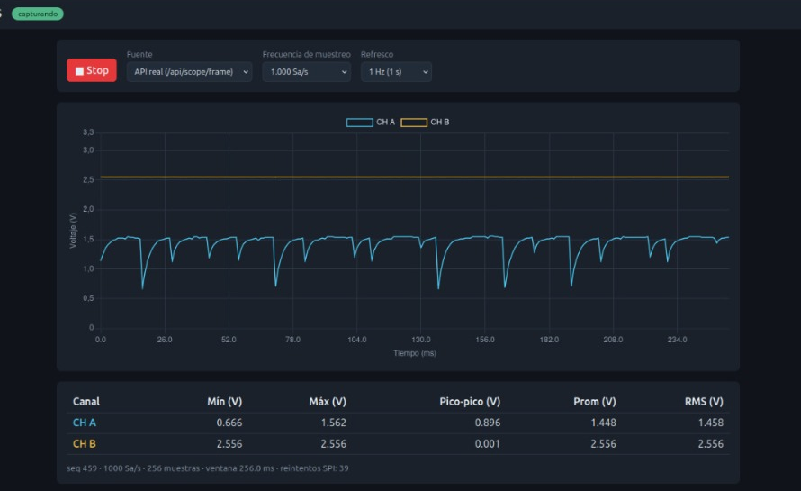
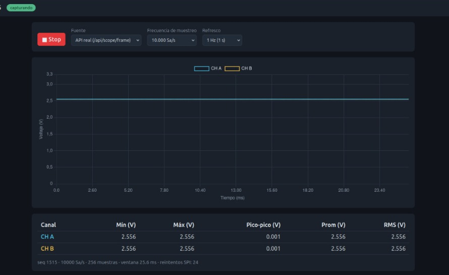

# 07. Dashboard

Carpeta [`dashboard/`](../../dashboard). Primera versión por David Henao Rojas; el backend de Juan Camilo lo sirve en `http://<IP_BEAGLEPLAY>:8000/`.

## 1. Qué muestra y qué permite

| Elemento | Detalle |
|---|---|
| Gráfica | Chart.js 4.6.1, **local** (`dashboard/vendor/chart.umd.js`), sin CDN. Canales **CH A** (azul) y **CH B** (amarillo) en voltios contra tiempo en ms. Eje Y fijo 0 a 3,3 V |
| Estadísticas | Mín, Máx, pico-pico, promedio y RMS por canal, sobre la ventana mostrada |
| Barra de estado | `seq`, frecuencia de muestreo, número de muestras, duración de la ventana, `modo test`, avisos (`OVERRUN`, `comando rechazado`, `ADC sin calibrar`) y `reintentos SPI: N` |
| **Start / Stop** | Inicia o detiene el refresco |
| **Fuente** | `Simulada` (senoidal y cuadrada sintéticas, sin hardware) o `API real` (`/api/scope/frame`) |
| **Frecuencia de muestreo** | 100 / 1.000 / 10.000 / 40.000 Sa/s. Con `API real` envía `POST /api/scope/config` |
| **Refresco** | 0,25 Hz (4 s, por defecto), 0,5 Hz o 1 Hz: rango del enunciado |

## 2. Capturas del sistema funcionando

Capturas reales tomadas el 2026-10-30 con la BeaglePlay y el ESP32-C6 (el navegador estaba en otro equipo de la red, `192.168.7.x:8000`). Recortadas para mostrar solo el dashboard.

**Modo de prueba, 2 MHz** (rampas fijas; valida SPI y protocolo de extremo a extremo): CH A sube de 0 a 0,193 V y CH B baja de 3,100 a 2,907 V, como corresponde a `i` y `4095 − i` en el protocolo v1.

**ADC real, sin señal aplicada** (antes de montar el potenciómetro; pines probablemente flotantes, ≈ 0,12 V con ruido):

**Potenciómetro en CH A, sin condensador:** CH B (2,556 V) es estable y CH A muestra caídas periódicas (hasta 0,666 V) que se recuperan exponencialmente. Con 39 reintentos SPI en esa captura.

**Con condensador** entre el cursor y GND, a 10 kSa/s: ambos canales planos en 2,556 V (pico-pico 0,001 V), 24 reintentos SPI.

> Los valores de las dos últimas capturas son del firmware v1, **sin calibrar**: el multímetro marcaba 3,28 V donde el dashboard 2,556 V. Ver [08-calibracion-adc.md](08-calibracion-adc.md).

## 3. Contrato con el backend

| Método y ruta | Detalle |
|---|---|
| `GET /api/scope/frame` | `{seq, rate_idx, fs_hz, window, flags, retries, a:[mV], b:[mV]}` |
| `POST /api/scope/config` | `{"rate_idx": 0..3}` |

El dashboard convierte `V = mV / 1000` (protocolo v2).

## 4. Lógica relevante de `scope.js`

- **Resincronización del preset**: el ESP32-C6 conserva el último preset recibido. Si la trama trae un `rate_idx` distinto al seleccionado (por ejemplo al recargar la página), el dashboard reenvía el seleccionado y muestra «ajustando frecuencia...» hasta la siguiente trama. Corrige el caso observado el 2026-10-30: el selector decía 1.000 Sa/s y el ESP32 seguía en 100 Sa/s.
- **Errores**: si la API responde distinto de 200 muestra `error: HTTP 500` en la insignia de estado; la causa está en el log del backend (`[ERROR REST] ...`) y en el `detail` de la respuesta.
- **Fuente simulada**: genera 256 muestras con ~4 y ~7 ciclos por ventana para cualquier preset; permite probar la interfaz sin hardware: `cd dashboard && python3 -m http.server 8080`.

## 5. Limitaciones

- Escala Y fija 0 a 3,3 V; sin auto-escala, cursores ni selector de ventana (el backend usa la ventana del esclavo, 256 por defecto).
- Sin disparo: la fase de una señal periódica cambia entre capturas.
- El refresco real depende de la duración de la ventana: a 100 Sa/s con 256 muestras cada captura tarda ≥ 2,56 s.
- El archivo `scope.js` no se ha revisado con un analizador de sintaxis (no hay Node.js en el entorno de desarrollo); su funcionamiento se comprobó en el navegador del equipo.
