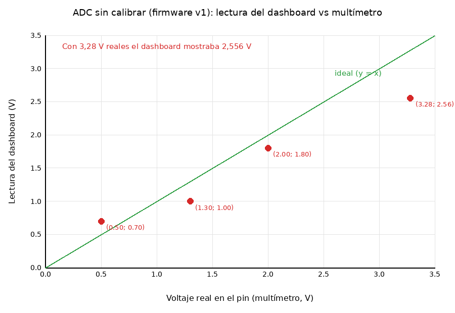

# 08. Calibración del ADC

## 1. Problema medido

Con el firmware v1 el dashboard convertía el código crudo del ADC con una recta ideal (`V = raw / 4095 × 3,1`). Al comparar con un multímetro (2026-10-30, potenciómetro en GPIO0) se vio que la lectura **no coincidía ni seguía una recta**:

| Multímetro (V) | Dashboard (V) | Error (V) |
|---|---|---|
| 0,50 | 0,70 | +0,20 |
| 1,30 | 1,00 | −0,30 |
| 2,00 | 1,80 | −0,20 |
| 3,28 | 2,556 | −0,72 |

Notas sobre estos datos:
- Son pocos puntos (4) y los tres primeros se anotaron redondeados a 1 decimal, así que el error de lectura es de ≈ ±0,05 V. El emparejamiento 1,3→1,0, 0,5→0,7 y 2,0→1,8 se asumió en el orden en que se reportaron.
- Un ajuste lineal (`dashboard ≈ 0,70 × real + 0,28`) deja residuos de hasta ±0,26 V: **la respuesta no es lineal**, por lo que una calibración con gain/offset en el SBC no habría bastado.
- Con 3,28 V reales, el ADC no estaba saturado (marcaba 2,556 V ≈ código 3376 de 4095 con la conversión de v1): el fondo de escala de 3,1 V que se había supuesto no se cumple en esta placa.

## 2. Solución: calibración en el firmware (protocolo v2)

El ESP32-C6 trae en su eFuse coeficientes de calibración de fábrica del ADC. ESP-IDF los aplica con el esquema **curve-fitting** (`adc_cali_create_scheme_curve_fitting`).

Implementación en [`firmware/main/adc_capture.c`](../../firmware/main/adc_capture.c):

1. En el arranque (`scope_link_start`), se construye **una tabla de 4096 entradas por canal** que convierte cada código de 12 bits en milivoltios (`adc_cali_raw_to_voltage` para cada código).
2. Durante la captura, convertir una muestra es **una sola lectura de tabla**: no consume CPU relevante a 80 kSa/s.
3. En el promedio de 100 Sa/s se promedian los códigos crudos (decimación 10) y se convierte el resultado.
4. Si la placa no trae datos de calibración, se usa una recta de respaldo (3100 mV a fondo de escala) y se levanta el flag **bit4 `ADC sin calibrar`**; el dashboard muestra «ADC sin calibrar».
5. El log al arrancar indica el esquema usado por canal: `canal 0: calibracion curve-fitting (eFuse)`.

Impacto en el resto del sistema:

| Elemento | Cambio |
|---|---|
| Protocolo | v1 → **v2**: las muestras son mV (ver [04](04-protocolo-spi.md)) |
| Dashboard | `V = mV / 1000` |
| Backend | Sin cambios: reenvía los valores tal cual |
| Binario | `release/osciloscopio_c6_v2.bin` (SHA-256 en [11](../Instrucciones_De_Uso/Instrucciones_De_Uso.md)) |

## 3. Estado de la verificación

- ✅ El firmware v2 compila (ESP-IDF 5.4.1) y las pruebas del protocolo en el PC pasan.
- ✅ **El firmware v2 arranca en una ESP32-C6 real** y el log confirma `calibracion curve-fitting (eFuse)` en los dos canales (2026-11-04, [09](09-pruebas-y-resultados.md), P-13): esa placa sí trae datos de calibración.
- 🟡 **Medición preliminar frente al multímetro:** cuatro puntos reportados por el usuario en CH A; diferencia dashboard menos multímetro de +0,004 a +0,035 V. Faltan más puntos, repeticiones e incertidumbre del instrumento para caracterizar la exactitud.
- ⚠️ Cerca de 0 V y de plena escala el ADC del ESP32-C6 sigue siendo menos preciso, incluso calibrado.

## 4. Procedimiento para verificarla (FW-11)

1. Flashear `release/osciloscopio_c6_v2.bin` ([11](../Instrucciones_De_Uso/Instrucciones_De_Uso.md)) con el monitor serie abierto y confirmar `calibracion curve-fitting (eFuse)` en ambos canales. Si aparece otro mensaje, la placa no tiene calibración.
2. Montar el potenciómetro ([03](03-hardware-y-conexiones.md)). Reiniciar el ESP32-C6 para salir del modo de prueba.
3. Con el potenciómetro quieto en cada punto, anotar **a la vez** el multímetro (2 decimales) y el **Prom** del dashboard (3 decimales). Cubrir puntos desde 0 V hasta el máximo seguro de la entrada, incluyendo niveles intermedios.
4. Calcular error absoluto y relativo por punto y dibujar la curva.

Resultados iniciales informados por el usuario el 2026-11-05 (CH A). Error con signo = dashboard − multímetro; error relativo = error absoluto / lectura del multímetro. En 0 V el error relativo no aplica.

| Punto | Multímetro (V) | Dashboard v2 (V) | Error (V) | Error (%) |
|---|---:|---:|---:|---:|
| 1 | 0,000 | 0,004 | +0,004 | N/A |
| 2 | 0,519 | 0,525 | +0,006 | 1,16 |
| 3 | 1,537 | 1,557 | +0,020 | 1,30 |
| 4 | 2,996 | 3,031 | +0,035 | 1,17 |

En estos cuatro puntos el error absoluto máximo observado fue 0,035 V (35 mV); el error relativo de los tres puntos distintos de cero fue de 1,16–1,30 %. Son lecturas puntuales, no una especificación de exactitud: no se registraron repeticiones, incertidumbre del multímetro ni variación temporal del promedio.

Si el error sigue siendo grande, las alternativas son una tabla de interpolación en el SBC con estos mismos puntos o limitar el rango útil del instrumento.
