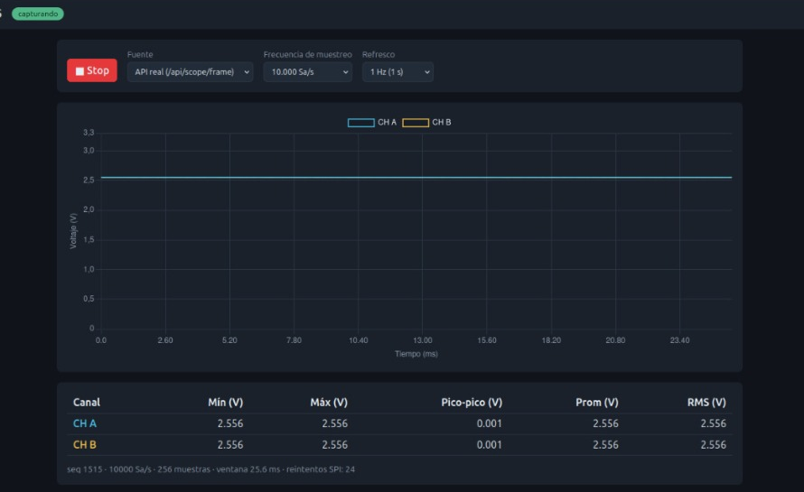

# 09. Pruebas y resultados

Bitácora cronológica de lo realizado hasta el 2026-11-03, con la evidencia disponible. Lo que no se ejecutó en hardware se indica de forma explícita. Las pruebas con la BeaglePlay las hizo el equipo del SBC (Juan Camilo); las de compilación y las del PC, David Henao Rojas.

## Resumen

| ID | Fecha | Prueba | Resultado |
|---|---|---|---|
| P-01 | 2026-10-28 | Compilar, flashear y arrancar el firmware v1 | ✅ |
| P-02 | 2026-10-28 | Pruebas unitarias del protocolo en el PC | ✅ 7 pruebas |
| P-03 | 2026-10-30 | Revisión del pinout mikroBUS | ✅ Corregido INT 11 → 15 |
| P-04 | 2026-10-30 | Primera lectura SPI desde la BeaglePlay (100 kHz) | ✅ Cabecera válida en la 2.ª transacción |
| P-05 | 2026-10-30 | Diagnóstico de captura completa (100 kHz y 2 MHz) | ❌ Se pierde ≈ 50 % de las transacciones; `ARM` nunca surtió efecto |
| P-06 | 2026-10-30 | Backend con reintentos: modo de prueba en el dashboard | ✅ a 2 MHz; ❌ a 100 kHz |
| P-07 | 2026-10-30 | Preset del dashboard contra el del ESP32-C6 | ✅ Corregido |
| P-08 | 2026-10-30 | ADC real con potenciómetro | 🟡 Datos reales; ruido periódico en CH A |
| P-09 | 2026-10-30 | Condensador en la entrada | ✅ Señal plana y estable |
| P-10 | 2026-10-30 | Presets de 10.000 y 40.000 Sa/s | ❌ Errores esporádicos a 10 kSa/s y constantes a 40 kSa/s |
| P-11 | 2026-10-30 | Exactitud del ADC sin calibrar | ❌ Errores de hasta 0,72 V |
| P-12 | 2026-11-01 | Firmware v2 con calibración | ✅ Compila (11-01); ✅ arranca en hardware con calibración de eFuse (P-13) |
| P-13 | 2026-11-04 | Arranque del firmware v2 en una ESP32-C6 real | ✅ Arranca sin reinicios; calibración eFuse en ambos canales |
| P-14 | 2026-11-04 | SPI con la BeaglePlay tras conectar el generador | ❌ Todo `00` en RX (en diagnóstico) |

## P-01. Compilación, flasheo y arranque (firmware v1)

- Entorno: WSL Ubuntu, ESP-IDF 5.4.1, `usbipd` para el USB, `/dev/ttyACM0`.
- `idf.py build`: correcto. Se flasheó la ESP32-C6-DevKitC-1 real.
- Monitor serie: `scope_link: SPI esclavo listo (SCLK=6 MOSI=7 MISO=2 CS=10 HS=3)`.

## P-02. Pruebas unitarias del protocolo (PC)

`make -C firmware/tests/host test` → `OK: todas las pruebas del protocolo pasaron` (comandos, cabecera con checksum y corrupción, presets, ventanas). Se repitió con el firmware v2.

## P-03. Corrección del pinout

La numeración de mikroBUS de la primera versión ponía INT en el pin 11 (en realidad SDA). El equipo señaló que INT es el **15**. Se adoptó la numeración en U, se añadió la tabla de 16 pines y se rehicieron los diagramas ([03](03-hardware-y-conexiones.md)). Se descargó la especificación mikroBUS v2.0; define solo el orden y los nombres de la serigrafía, no numera los pines. ⚠️ No contrastado con el esquemático de la BeaglePlay.

## P-04. Primera lectura SPI (`prueba_directa_spi.py`, 100 kHz, modo 0)

Se envió `NOP` = `00 00 00 5A` más 12 ceros, 5 intentos:

```
PRUEBA 1  RX: FF FF FF FF FF FF FF FF FF FF FF FF FF FF FF FF     -> sin respuesta válida
PRUEBA 2  RX: E5 00 00 01 00 01 00 00 E8 03 00 00 02 0C 01 01     -> SPI OK: cabecera válida
```

Decodificación de la 2.ª: `magic E5`, estado `IDLE`, flags 0, preset 1, ventana `0x0100` = 256, `seq` 0, `fs_hz` `0x03E8` = 1000, 2 canales, 12 bits, versión 1, checksum `01`.

**Conclusión:** cableado, pinmux y `/dev/spidev0.0` funcionan. Pero la primera transacción devolvió todo `0xFF`: ya aparece la pérdida de transacciones.

## P-05. Diagnóstico de captura (`diagnostico_captura.py`)

Secuencia: NOP, RESET, NOP, SET_RATE, NOP, TESTMODE, NOP, ARM y 400 sondeos con NOP cada 10 ms.

| Velocidad | Sondeos válidos | Sondeos inválidos | Patrón | `READY` alcanzado |
|---|---|---|---|---|
| 100 kHz | 178 de 400 | 222 | Casi alternado (`oFoFFoFoFo…`) | No |
| 2 MHz | 200 de 400 | 200 | **Exactamente alternado** (`FoFoFo…`) | No |

Observaciones:

- Dos tipos de respuesta inválida: todo `0xFF`, y `0xFF…` seguido de bytes de cabecera desplazados (por ejemplo `ff×11 94 00 00 04 00`), es decir, el esclavo se armó a mitad de la transacción.
- Tras una transacción corrupta, la cabecera siguiente traía el flag **bit2** (checksum de comando inválido): el esclavo recibió un comando basura y lo descartó.
- El `ARM` cayó en una transacción inválida y no se ejecutó. El estado siguió en `IDLE` los 400 sondeos. Por eso `capture_frame` original devolvía error (HTTP 500).
- La cabecera válida es correcta incluso a 2 MHz: el problema no es la velocidad ni el cableado.
- **Causa raíz no identificada.** Hipótesis por verificar: tiempo que tarda el esclavo en volver a armar la transacción tras cada una (`spi_slave_transmit` con cola de 1), integridad de señal en cables sueltos, o el comportamiento de CS en `spidev`.

**Respuesta aplicada (en el maestro):** reintentos hasta cabecera válida, candado, comprobación de `seq`, plazo calculado ([06](06-backend-beagleplay.md)). El esclavo no se modificó.

## P-06. Backend con reintentos y dashboard

- **2 MHz:** sin errores en el servidor. El dashboard mostró las rampas del modo de prueba: CH A de 0 a 0,193 V y CH B de 3,100 a 2,907 V, que coincide con `i` y `4095 − i` (captura en [07](07-dashboard.md)). Valida el SPI, la cabecera, el desempaquetado y la API de extremo a extremo.
- **100 kHz:** el dashboard seguía recibiendo `HTTP 500` (`[ERROR REST] Falla al capturar trama`). Con tantas transacciones perdidas a baja velocidad, los 12 reintentos por transacción no bastaron. Se adopta **2 MHz** como velocidad de trabajo, que además cumple los 2 Mbit/s que pidió el docente.

## P-07. Preset desincronizado

La barra de estado decía `100 Sa/s · ventana 2560 ms` con el selector en 1.000 Sa/s: el dashboard nunca enviaba el preset al cargar y el ESP32-C6 conservaba el anterior. Corrección: si `rate_idx` de la trama difiere del seleccionado, el dashboard lo reenvía ([07](07-dashboard.md)). Verificado después con los cambios de preset en el dashboard.

## P-08. ADC real y potenciómetro

- Sin señal: ≈ 0,12 V con ruido (pines flotantes). El firmware salió del modo de prueba al reiniciar.
- Con potenciómetro (sin condensador): CH B estable en 2,556 V y **CH A con caídas periódicas** cada ≈ 26 ms hasta 0,666 V que se recuperaban exponencialmente; 39 reintentos SPI en esa captura (a 1 kSa/s).
- **Hipótesis** (no confirmada): pulsos acoplados desde el tráfico SPI a una entrada de alta impedancia. Mitigación aplicada: el backend no consulta por SPI durante el muestreo.

## P-09. Condensador de filtrado

Con un condensador entre el cursor y GND (CH A en el cursor; CH B en el otro extremo de la resistencia de 1 kΩ), a 10.000 Sa/s: **ambas líneas planas en 2,556 V**, pico-pico 0,001 V, 24 reintentos SPI. Como se aplicaron a la vez la espera sin tráfico y el condensador, **no se sabe cuál de los dos eliminó el ruido**. Ambos canales leen lo mismo por estar en el mismo nodo.



## P-10. Presets de 10.000 y 40.000 Sa/s

- A **100 y 1.000 Sa/s** todo correcto.
- A **10.000 Sa/s** el dashboard mostró avisos esporádicos de «checksum de comando» (el flag bit2 pegado de una transacción perdida). Se enmascaró el flag y se expone `retries`.
- A **40.000 Sa/s** el error es **constante**. El mensaje exacto no se registró. Se necesita el log del backend (`[ERROR REST] ...` ahora con la causa) y el monitor serie del ESP32-C6 (`capture: captura fallida: ...`). Causas posibles: overrun del ADC (flag `OVERRUN`), fallo del ADC a 80 kSa/s (cerca del límite de 83,3 kSa/s) o problema de SPI.

## P-11. Exactitud del ADC sin calibrar

Multímetro contra dashboard (firmware v1): 0,50→0,70 V, 1,30→1,00 V, 2,00→1,80 V, 3,28→2,556 V. Respuesta **no lineal**, error hasta 0,72 V ([08](08-calibracion-adc.md)). El dashboard no limitaba el valor: el dato crudo ya era bajo.

## P-12. Firmware v2

Calibración por eFuse con tabla de 4096 entradas por canal; protocolo v2 (mV). Compila con ESP-IDF 5.4.1 y las pruebas unitarias pasan (2026-11-01). El arranque en hardware se registra en P-13.

## P-13. Arranque del firmware v2 en hardware (2026-11-04)

Un integrante compiló el firmware desde el repositorio (versión `b3b4318`, compilado el 2026-11-04 12:36 con ESP-IDF 5.4.1), lo flasheó en una ESP32-C6 y abrió el monitor serie (`miniterm`, 115200). Salida relevante:

```
I (250) main: Osciloscopio ESP32-C6: esclavo SPI + ADC continuo
I (269) capture: canal 0: calibracion curve-fitting (eFuse)
I (285) capture: canal 1: calibracion curve-fitting (eFuse)
I (285) gpio: GPIO[3]| InputEn: 0| OutputEn: 1| ...
I (288) scope_link: SPI esclavo listo (SCLK=6 MOSI=7 MISO=2 CS=10 HS=3)
I (294) main_task: Returned from app_main()
```

Conclusiones:
- El firmware v2 **arranca sin reinicios ni errores** (descarta un desbordamiento de pila por la tabla de calibración).
- **Esa placa sí trae los datos de calibración en la eFuse** (esquema curve-fitting en ambos canales). Revisión del chip v0.2, eFuse v0.3.
- Se confirma la asignación de pines SPI y que INT = GPIO3 es una salida.
- Pendiente: medir cuánto mejora la exactitud frente al multímetro ([08](08-calibracion-adc.md)).
- Observación menor: el chip detectado tiene 16 MB de flash y el firmware usa 4 MB (el arranque lo avisa y usa 4 MB); no afecta.

## P-14. SPI sin respuesta tras conectar el generador (2026-11-04, en diagnóstico)

Con el backend a 100 kHz (valor por defecto antiguo): `[ERROR REST] sin cabecera valida antes de ARM` (HTTP 500). Con `prueba_directa_spi.py` las 5 pruebas devuelven **todos los bytes `00`** (el 2026-10-30 devolvían `FF` en las tramas perdidas y una cabecera válida en otras). Pulsar RESET en el ESP32-C6 no lo corrigió. El monitor serie (P-13) muestra que el firmware está activo y el esclavo SPI iniciado, por lo que se sospecha del cableado de MISO, GND o CS, o de la configuración de la BeaglePlay. `00` fijo significa MISO forzado a 0 V. Pruebas de aislamiento propuestas: desconectar MISO en el ESP32-C6 y repetir; bucle MISO-MOSI en el mikroBUS sin el ESP32-C6; medir GPIO3 (INT, ≈ 3,3 V en reposo si el esclavo está armado). Resultado pendiente. Se preparó un firmware con contador de transacciones (`release/osciloscopio_c6_v2_diag.bin`, ver [11](11-guia-flasheo-esp32c6.md), sección 4.2) para saber si el ESP32-C6 recibe algo de la BeaglePlay.

## Hallazgos principales

1. El enlace SPI **funciona** a 2 MHz, pero **pierde cerca de la mitad de las transacciones**. Es el problema técnico abierto más importante porque afecta latencia y, potencialmente, la integridad a 40 kSa/s.
2. El maestro debe validar y reintentar siempre; con eso la captura completa funciona.
3. El ADC sin calibrar tenía errores de hasta 0,72 V; la calibración está implementada pero sin verificar.
4. El preset de 40 kSa/s (bonificación) falla en la práctica y no está diagnosticado.
5. Todavía no hay mediciones con instrumentos (frecuencia de muestreo, reloj SPI) ni con una señal periódica.
