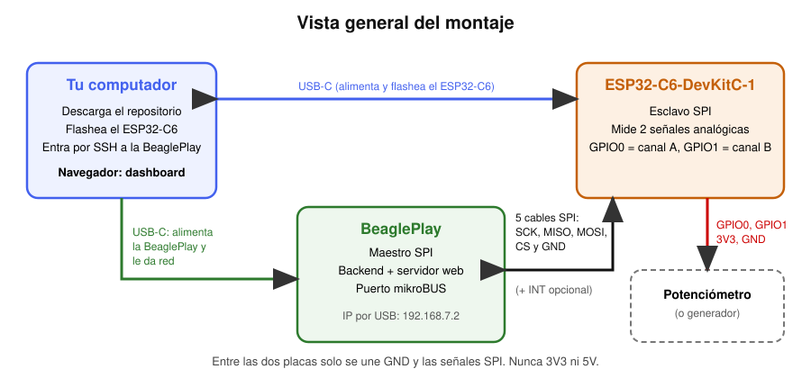
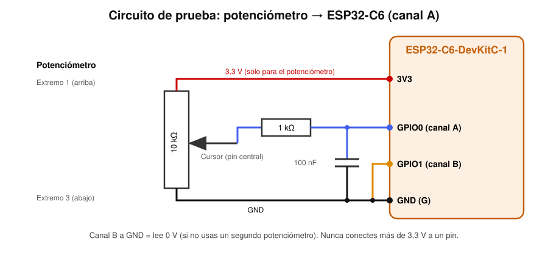

# Instrucciones de uso: arma tu propio osciloscopio (BeaglePlay + ESP32-C6)

Esta guía te lleva **desde cero** hasta ver en tu navegador la gráfica de dos señales eléctricas medidas por el sistema. No necesitas saber de osciloscopios ni de electrónica. No tienes que modificar ningún código ni instalar entornos de programación pesados: **copias el repositorio, flasheas el ESP32-C6, montas los cables y enciendes todo**.

Tiempo estimado: 1 a 2 horas la primera vez.

> **Estado del proyecto (2026-11-05).** El sistema funciona de extremo a extremo con 100, 1.000 y 10.000 muestras por segundo. Hay limitaciones conocidas que **no son errores tuyos**: el preset de 40.000 Sa/s falla, cerca de la mitad de las lecturas SPI se pierden y el software las reintenta, y la calibración del ADC de la versión actual del firmware (v2) todavía no se ha medido con instrumentos. Están explicadas en la sección 11.
>
> La BeaglePlay del equipo usa **Debian GNU/Linux 13.7 «trixie»** (imagen entregada por el profesor). Se **alimenta con un cable USB-C** y se configuró por **consola serie con minicom** usando un **adaptador USB a UART**. Los pasos marcados con ⚠️ son detalles que no se han podido verificar; se indica cómo comprobarlos.

## Índice

0. [¿Qué vas a construir?](#0-qué-vas-a-construir)
1. [Lista de materiales](#1-lista-de-materiales)
2. [Reglas de seguridad (léelas antes de conectar nada)](#2-reglas-de-seguridad)
3. [Paso 1: descargar el repositorio](#3-paso-1-descargar-el-repositorio)
4. [Paso 2: flashear el ESP32-C6](#4-paso-2-flashear-el-esp32-c6)
5. [Paso 3: preparar la BeaglePlay](#5-paso-3-preparar-la-beagleplay)
6. [Paso 4: montaje físico](#6-paso-4-montaje-físico)
7. [Paso 5: comprobar que las placas se hablan](#7-paso-5-comprobar-que-las-placas-se-hablan)
8. [Paso 6: dejar el sistema arrancando solo y abrir el dashboard](#8-paso-6-dejar-el-sistema-arrancando-solo-y-abrir-el-dashboard)
9. [Cómo usar el dashboard](#9-cómo-usar-el-dashboard)
10. [Problemas comunes y soluciones](#10-problemas-comunes-y-soluciones)
11. [Limitaciones conocidas](#11-limitaciones-conocidas)
12. [Apagar y guardar](#12-apagar-y-guardar)
13. [Resumen de comandos](#13-resumen-de-comandos)

---

## 0. ¿Qué vas a construir?

Un **osciloscopio** es un instrumento que dibuja cómo cambia un **voltaje** (la «fuerza» de una señal eléctrica) a lo largo del tiempo. Este montaje mide **dos señales a la vez** (canal A y canal B) y las dibuja en una página web.

```
Señal (0 a 3,1 V) ─► ESP32-C6 ══SPI══► BeaglePlay ──red──► Navegador de tu PC
   (la mide)        (la convierte      (la guarda y         (la dibuja)
                     en números)        la publica)
```



| Pieza | Qué hace, en palabras simples |
|---|---|
| **ESP32-C6** (microcontrolador) | Un computador diminuto con un «medidor de voltaje» (el ADC). Toma muchas mediciones por segundo |
| **BeaglePlay** (SBC, computador de placa única) | Un computador pequeño con Linux. Pide los datos al ESP32-C6 y los publica como una página web |
| **SPI** | El «cable de conversación» entre las dos placas (4 hilos de datos más tierra) |
| **Dashboard** | La página web con la gráfica, que ves desde tu PC |

### Glosario mínimo

| Palabra | Significa |
|---|---|
| **Voltaje (V)** | Lo que se mide. Aquí de 0 a unos 3,1 voltios |
| **Muestra** | Una medición de voltaje en un instante |
| **Sa/s** (muestras por segundo) | Cuántas mediciones se toman cada segundo. 1.000 Sa/s = una medición cada milésima de segundo |
| **Canal** | Una de las dos entradas de señal (A o B) |
| **GND (tierra)** | El «cero voltios» común. Todas las piezas deben compartirlo |
| **GPIO** | Un pin del microcontrolador (GPIO0 = pin número 0) |
| **Flashear** | Grabar el programa (firmware) en el microcontrolador |
| **Firmware** | El programa que corre dentro del ESP32-C6 |
| **mikroBUS** | El conector estándar de 16 pines de la BeaglePlay donde se conectan los cables SPI |
| **Potenciómetro** | Una perilla que entrega un voltaje ajustable; sirve de «señal de prueba» |

---

## 1. Lista de materiales

### Hardware

| # | Cantidad | Elemento | Notas |
|---|---|---|---|
| 1 | 1 | **ESP32-C6-DevKitC-1** | Debe ser exactamente este modelo (los pines están asignados para él) |
| 2 | 1 | **BeaglePlay** | Con la imagen **Debian 13.7 «trixie»** que entregó el profesor (la que usó el equipo). Debe traer habilitado `/dev/spidev0.0` |
| 3 | 2 | Cables **USB-C de datos** | Uno para cada placa. Los de «solo carga» no sirven para flashear ni para la red |
| 3b | 1 | **Adaptador USB a UART** de **3,3 V** (FTDI, CP2102 o CH340) con 3 cables | Es lo que usó el equipo para entrar a la consola de la BeaglePlay con minicom. **Debe ser de 3,3 V, no de 5 V**. Opcional si prefieres solo SSH por la red USB |
| 4 | 6 | Cables Dupont **macho-hembra** | Para unir el conector mikroBUS de la BeaglePlay (hembra: tiene orificios) con los pines del ESP32-C6. Uno es opcional |
| 5 | 1 | **Potenciómetro de 10 kΩ** | Señal de prueba (10 kΩ es el valor recomendado; el equipo no registró el que usó). Alternativa: un generador de señales (0 a 3,1 V, solo valores positivos) |
| 6 | 1 | Resistencia de **1 kΩ** | Protege la entrada analógica |
| 7 | 1 | Condensador de **100 nF** (cerámico) | Reduce el ruido. ⚠️ El equipo no registró el valor usado; 100 nF es el valor típico y recomendado |
| 8 | 1 | Protoboard (placa de pruebas) | Para el circuito del potenciómetro |
| 9 | 6 a 8 | Cables Dupont macho-macho | Para el circuito en la protoboard |
| 10 | 1 | Multímetro | **Opcional**, para comparar voltajes |

### Lo que necesitas en tu computador

| Elemento | Para qué |
|---|---|
| Windows, Linux o WSL (Ubuntu) | Para flashear y conectarte |
| **Python 3** | Para ejecutar la herramienta de flasheo (`esptool`) |
| **Git** (o descargar el ZIP desde GitHub) | Para copiar el repositorio |
| Un cliente **SSH** | Ya viene en Windows 10/11 (PowerShell) y en Linux |
| Un navegador web | Para ver el dashboard |
| Conexión a **Internet** | Para instalar `esptool` y, si faltan, los paquetes de la BeaglePlay |

### Lo que NO necesitas

- No necesitas ESP-IDF ni compilar nada: el firmware ya está compilado en `release/`.
- No necesitas generador de señales ni analizador lógico.
- No tienes que modificar el código.

---

## 2. Reglas de seguridad

1. **Voltaje máximo en cualquier pin: 3,3 V.** Más puede dañar el ESP32-C6. La entrada analógica trabaja de **0 a ~3,1 V y solo positivo** (nunca voltajes negativos).
2. **Entre las dos placas se unen únicamente GND y las señales SPI. NUNCA unas 3V3 ni 5V de una placa con la otra.** Cada placa se alimenta por su propio cable USB-C.
3. **Conecta los cables con todo apagado** (ambas placas sin USB). Revisa antes de encender.
4. **Guíate por los nombres impresos** junto a cada pin (CS, SCK, MISO, MOSI, GND). Los números de esta guía son de apoyo.
5. Toca las placas por los bordes y descárgate antes (toca un objeto metálico con toma de tierra): la electricidad estática las puede dañar.
6. No quites la alimentación de la BeaglePlay sin apagarla antes (ver sección 12): puede corromper su memoria.

---

## 3. Paso 1: descargar el repositorio

**Qué haces:** copiar los archivos del proyecto a tu PC.

Abre una terminal (en Windows: PowerShell; en Linux/WSL: Terminal) y escribe:

```bash
git clone https://github.com/dahenaor-source/Osciloscopio-Linux-Embebido.git
cd Osciloscopio-Linux-Embebido
```

**Sin Git:** en la página del repositorio pulsa **Code → Download ZIP**, descomprime y abre una terminal dentro de la carpeta resultante.

**Comprobación:** deben existir las carpetas `release`, `dashboard`, `beagleplay` y `docs`:

```bash
ls            # Linux/WSL
dir           # Windows PowerShell
```

---

## 4. Paso 2: flashear el ESP32-C6

**Qué haces:** grabar el programa `release/osciloscopio_c6_v2.bin` dentro del ESP32-C6. Esto se hace una sola vez (el programa queda guardado aunque lo desconectes).

### 4.1 Conecta la placa

1. Conecta el ESP32-C6 a tu PC con un cable USB-C de datos. La DevKitC-1 tiene **dos** conectores USB-C: usa el rotulado **USB** (el que usó el equipo). El rotulado UART también sirve.
2. Debe encenderse un LED en la placa.

### 4.2 Instala la herramienta de flasheo

| Sistema | Comando |
|---|---|
| **Windows** (instala Python desde python.org y marca «Add Python to PATH») | `py -m pip install esptool` |
| **Linux / WSL** | `python3 -m venv ~/venv-esp && . ~/venv-esp/bin/activate && pip install esptool` |

### 4.3 Averigua el puerto de la placa

| Sistema | Cómo |
|---|---|
| **Windows** | Administrador de dispositivos → «Puertos (COM y LPT)». Aparece, por ejemplo, `COM5`. Si no aparece, prueba otro cable |
| **Linux** | `ls /dev/ttyACM* /dev/ttyUSB*` (por ejemplo `/dev/ttyACM0`). Si dice «permiso denegado»: `sudo usermod -aG dialout $USER` y reinicia la sesión |
| **WSL** | WSL no ve el USB por defecto. Sigue la sección «Acceso al USB desde WSL (usbipd)» de [05-firmware-esp32c6.md](../Documentaci%C3%B3n_General/05-firmware-esp32c6.md); después el puerto es `/dev/ttyACM0` |

### 4.4 Flashea

Reemplaza `COM5` o `/dev/ttyACM0` por tu puerto. Ejecuta el comando **desde la carpeta del repositorio**:

```bash
# Windows (PowerShell)
py -m esptool --chip esp32c6 -p COM5 -b 460800 write_flash 0x0 release\osciloscopio_c6_v2.bin

# Linux / WSL
python3 -m esptool --chip esp32c6 -p /dev/ttyACM0 -b 460800 write_flash 0x0 release/osciloscopio_c6_v2.bin
```

**Resultado esperado:** una barra de progreso y al final `Hash of data verified.` y `Hard resetting via RTS pin...`.

**Si no conecta** (`Failed to connect` o `Timed out waiting for packet header`): mantén pulsado el botón **BOOT** de la placa, pulsa y suelta **RESET** (o **EN**), suelta **BOOT** y repite el comando.

**Opcional, comprobar que el archivo es el correcto:** su huella SHA-256 debe ser `1c51a29df9c500cb06603873d2eb6444d1340b4ed6fb0c01d0ccdb8b76a5ac9c`.

```bash
sha256sum release/osciloscopio_c6_v2.bin               # Linux / WSL
Get-FileHash release\osciloscopio_c6_v2.bin -Algorithm SHA256    # Windows
```

### 4.5 Comprueba que arrancó

Abre el monitor serie (muestra lo que la placa escribe):

```bash
py -m serial.tools.miniterm COM5 115200              # Windows
python3 -m serial.tools.miniterm /dev/ttyACM0 115200   # Linux / WSL
```

Pulsa el botón **RESET** de la placa. Debes ver un mensaje que incluye:

```
scope_link: SPI esclavo listo (SCLK=6 MOSI=7 MISO=2 CS=10 HS=3)
```

Con el firmware v2 aparecen además líneas como `capture: canal 0: calibracion curve-fitting (eFuse)` (una por canal). Esas líneas se verificaron en una placa real (2026-11-04). Si en su lugar aparece un nombre de error, el sistema funciona igual, pero el dashboard mostrará «ADC sin calibrar» y los voltajes serán aproximados.

Para salir del monitor: `Ctrl + ]`. Luego **desconecta el cable USB** para el montaje.

---

## 5. Paso 3: preparar la BeaglePlay

**Qué haces:** encender la BeaglePlay, conectarte a ella desde tu PC, copiarle el proyecto y comprobar que tiene lo necesario. **Aún no conectes los cables SPI.**

### 5.1 Imagen de Linux

La BeaglePlay del equipo funciona con **Debian GNU/Linux 13.7 «trixie»** (imagen que entregó el profesor). Se comprobó con:

```
$ cat /etc/os-release
PRETTY_NAME="Debian GNU/Linux 13 (trixie)"
VERSION_ID="13"
DEBIAN_VERSION_FULL=13.7
```

Si tu placa ya inicia Linux, comprueba su versión con ese mismo comando: la guía se probó con esta. Si tienes que grabar una imagen en una microSD, usa un programa como **balenaEtcher** con la imagen que te dé el profesor o una imagen Debian oficial para BeaglePlay de BeagleBoard.org.

### 5.2 Enciéndela y conéctate

1. Conecta la BeaglePlay a tu PC con un cable **USB-C** al puerto USB-C de la placa. Eso la **alimenta** y, según la documentación oficial de BeagleBoard.org, también crea una **red USB** entre ambos (el equipo abrió el dashboard en `192.168.7.2:8000` por este mismo cable).
2. Espera **1 a 2 minutos** a que arranque Linux.
3. Desde tu PC, conéctate por SSH. Por USB, la BeaglePlay tiene la dirección **192.168.7.2**:

```bash
ssh USUARIO@192.168.7.2
```

Reemplaza `USUARIO` por el usuario de tu imagen. El equipo usó `camilo`; ⚠️ en las imágenes oficiales de BeagleBoard.org el usuario es `debian` con contraseña `temppwd`. Pregunta al profesor si no lo sabes. Responde `yes` a la pregunta de confianza y escribe la contraseña (no se ve al escribir).

**Resultado esperado:** un mensaje de bienvenida y un prompt como `usuario@BeagleBone:~$`.

**Si no responde:** en Windows puede faltar el driver de red USB (RNDIS/CDC); revisa el Administrador de dispositivos. Alternativa: conecta la BeaglePlay por cable **Ethernet** a tu router y busca su IP. Otra alternativa es la **consola serie** (siguiente apartado).

#### Consola serie con minicom (lo que usó el equipo)

El equipo alimentó la placa con el cable USB-C y la configuró con **minicom** a través de un **adaptador USB a UART**. La consola serie funciona sin red, así que sirve la primera vez (para crear el usuario) o cuando el SSH no responde.

**Conexión** (con la BeaglePlay **apagada**, sin USB-C):

| Adaptador USB-UART | BeaglePlay (conector de depuración UART) |
|---|---|
| **GND** | **GND** |
| **RX** | **TX** |
| **TX** | **RX** |
| VCC / 5 V / 3,3 V | **No conectar** (la placa se alimenta por su USB-C) |

Los cables **se cruzan**: TX de uno va a RX del otro. El adaptador debe ser de **3,3 V**; uno de 5 V puede dañar la placa. Identifica los pines por lo impreso en la placa; según la documentación de BeagleBoard.org, el pin 1 (GND, cable negro de los adaptadores FTDI) es el marcado con un punto blanco. ⚠️ No se comprobó contra la serigrafía de la BeaglePlay del equipo: confírmalo en la placa y en <https://docs.beagleboard.org/boards/beagleplay/>.

**En tu PC (Linux/WSL):**

```bash
sudo apt install -y minicom
ls /dev/ttyUSB* /dev/ttyACM*                     # conecta el adaptador y mira qué puerto aparece
sudo minicom -D /dev/ttyUSB0 -b 115200           # cambia ttyUSB0 por tu puerto
```

- Ajustes (los valores por defecto de las placas BeagleBoard.org): **115200 baudios, 8 bits, sin paridad, 1 bit de parada, sin control de flujo**. Se cambian con `Ctrl+A` y luego `O` (*Configure minicom* → *Serial port setup*). En minicom, desactiva el control de flujo por hardware si no puedes escribir.
- Conecta ahora el USB-C de la BeaglePlay para encenderla: verás el arranque. Cuando aparezca `login:`, entra con tu usuario (el equipo usa `camilo`).
- Salir de minicom: `Ctrl+A`, luego `X`.
- En Windows puedes usar PuTTY (tipo *Serial*, el `COMx` del adaptador, 115200) en lugar de minicom. En WSL, el adaptador necesita `usbipd attach` (ver [05](../Documentaci%C3%B3n_General/05-firmware-esp32c6.md)).

⚠️ El nombre del puerto (`/dev/ttyUSB0` es lo habitual en Linux, según la documentación de BeagleBoard.org) depende de tu adaptador; el equipo no lo registró.

### 5.3 Copia el repositorio a la BeaglePlay

**Opción A, desde la BeaglePlay (si tiene Internet):** en la sesión SSH:

```bash
git clone https://github.com/dahenaor-source/Osciloscopio-Linux-Embebido.git
```

**Opción B, desde tu PC (no requiere Internet en la BeaglePlay).** En una terminal de tu PC, **fuera** de la sesión SSH y desde la carpeta que contiene el repositorio:

```bash
scp -r Osciloscopio-Linux-Embebido USUARIO@192.168.7.2:~/
```

En ambos casos queda la carpeta `~/Osciloscopio-Linux-Embebido` en la BeaglePlay.

### 5.4 Comprueba el puerto SPI

En la sesión SSH de la BeaglePlay:

```bash
ls /dev/spidev*
```

**Resultado esperado:** aparece `/dev/spidev0.0`. El software usa exactamente ese nombre.

⚠️ Si no existe, tu imagen no trae habilitado el SPI del mikroBUS. En la imagen del equipo ya venía habilitado y **no hubo que configurar nada**, por eso este paso no está documentado. Consulta con el profesor y revisa la [documentación del backend](../Documentación_General/06-backend-beagleplay.md); no continúes hasta que exista.

### 5.5 Instala y comprueba las dependencias de Python

(Debian 13 trae Python 3.13. Necesitas Internet en la BeaglePlay para este paso, una sola vez.)

El backend necesita `fastapi`, `uvicorn` y `spidev`. El equipo los instaló así en la BeaglePlay (sesión SSH o minicom):

```bash
sudo apt update
sudo apt install python3-pip python3-dev -y

pip3 install fastapi uvicorn spidev
pip3 install fastapi uvicorn spidev --break-system-packages
```

**Por qué dos comandos `pip3`:** Debian 13 protege el Python del sistema (PEP 668). El primero normalmente termina en un error `externally-managed-environment`; el segundo, con `--break-system-packages`, sí instala. Puedes ejecutar solo el segundo. Se instalan para tu usuario, sin `sudo`.

**Comprobación:**

```bash
sudo python3 -c "import fastapi, uvicorn, spidev; print('Todo instalado')"
```

- Si escribe `Todo instalado`: sigue. (Con este mismo método el equipo ejecutó después `sudo python3 prueba_directa_spi.py` y el backend sin problemas.)
- Si da `ModuleNotFoundError` con `sudo` pero los paquetes sí están instalados, prueba `sudo -E python3 ...` (conserva tu entorno, donde pip dejó los paquetes). Por eso el backend se arranca con `sudo -E`.

### 5.6 Apaga la BeaglePlay para el montaje

```bash
sudo poweroff
```

Espera a que se apaguen los LED (unos 10 segundos) y desconecta el cable USB-C.

---

## 6. Paso 4: montaje físico

> **Todo desconectado de la corriente.** Ni la BeaglePlay ni el ESP32-C6 deben tener cable USB mientras conectas los cables.

### 6.1 Cables SPI: BeaglePlay (mikroBUS) ↔ ESP32-C6

Se usan **5 cables obligatorios** (SCK, MISO, MOSI, CS y GND) y **1 opcional** (INT; el software actual no lo usa, pero déjalo conectado si quieres el montaje completo).

| # | Señal | Pin en el mikroBUS de la BeaglePlay (nombre impreso) | Pin del ESP32-C6 (número impreso) | Color sugerido |
|---|---|---|---|---|
| 1 | **SCK** (reloj) | `SCK` (pin 4) | **6** | Amarillo |
| 2 | **MISO** (datos hacia la BeaglePlay) | `MISO` (pin 5) | **2** | Verde |
| 3 | **MOSI** (datos hacia el ESP32-C6) | `MOSI` (pin 6) | **7** | Azul |
| 4 | **CS** (selección de chip) | `CS` (pin 3) | **10** | Naranja |
| 5 | **GND** (tierra) | `GND` (pin 8, o pin 9 del otro lado) | **G** (cualquier pin GND) | Negro |
| 6 | INT (opcional) | `INT` (pin 15) | **3** | Blanco |

**No conectes:** `+3.3V` (pin 7), `+5V` (pin 10), `RST`, `AN`, `PWM`, `RX`, `TX`, `SCL`, `SDA`.

Cómo leer el conector mikroBUS de la BeaglePlay (vista desde arriba, con el logo «mikroBUS» hacia arriba): son dos filas de 8 orificios. Cada orificio tiene su nombre impreso:

| Fila izquierda (de arriba abajo) | | Fila derecha (de abajo arriba) |
|---|---|---|
| AN, RST, **CS**, **SCK**, **MISO**, **MOSI**, +3.3V, **GND** | | GND, +5V, SDA, SCL, TX, RX, **INT**, PWM |


⚠️ La numeración 1 a 16 se confirmó con el equipo, pero **no se ha contrastado con el esquemático de la BeaglePlay**. Si el nombre impreso y el número de esta tabla no coinciden, **manda el nombre impreso**. Hay más detalle en [03-hardware-y-conexiones.md](../Documentaci%C3%B3n_General/03-hardware-y-conexiones.md).

**Pasos:**

1. Mira cada pin del ESP32-C6: el **número** está serigrafiado junto al pin (busca `6`, `2`, `7`, `10`, `3` y `G`).
2. Conecta el extremo **macho** de cada cable al orificio correspondiente del mikroBUS (según la tabla) y el extremo **hembra** al pin del ESP32-C6.
3. Haz un solo cable a la vez y márcalo en la tabla.
4. Revisa que ningún cable toque otro pin vecino (los pines de `MOSI`, `+3.3V` y `GND` están juntos).

### 6.2 Señal de prueba: potenciómetro (circuito en la protoboard)

El potenciómetro tiene **3 patas**: dos extremos y una central (el *cursor*). Al girar la perilla, el voltaje de la pata central sube o baja entre 0 V y 3,3 V.



| # | De | A |
|---|---|---|
| 1 | Pata **extremo 1** del potenciómetro | Pin **3V3** del ESP32-C6 (este 3V3 solo alimenta el potenciómetro) |
| 2 | Pata **extremo 3** del potenciómetro | Pin **G** (GND) del ESP32-C6 |
| 3 | Pata **central** (cursor) | Un terminal de la resistencia de **1 kΩ** |
| 4 | Otro terminal de la resistencia de 1 kΩ | Pin **0** del ESP32-C6 (**GPIO0 = canal A**) |
| 5 | Una pata del **condensador de 100 nF** | El mismo punto del paso 4 (entre la resistencia y el pin 0) |
| 6 | La otra pata del condensador | GND |
| 7 | Pin **1** del ESP32-C6 (**GPIO1 = canal B**) | GND, si no usas un segundo potenciómetro (el canal B leerá 0 V) |

Para usar **dos señales**, repite los pasos 1 a 6 con un segundo potenciómetro y conéctalo al pin **1** (GPIO1). Si no tienes potenciómetro, puedes usar un generador de señales con salida de 0 a 3,1 V y **offset positivo**; su tierra va a GND del ESP32-C6.

**Importante:** las pruebas del equipo se hicieron con el condensador. Sin él, se vio ruido en el canal A (ver sección 10).

### 6.3 Revisión antes de encender

Marca cada punto:

- [ ] Hay **5 cables SPI** y cada uno va al nombre correcto (SCK, MISO, MOSI, CS y GND).
- [ ] **Ningún** cable va a `+3.3V` ni a `+5V` del mikroBUS.
- [ ] El potenciómetro tiene un extremo en 3V3 y el otro en GND del ESP32-C6, y el cursor entra a GPIO0 por la resistencia.
- [ ] Ningún cable toca un pin vecino y no hay cables sueltos.
- [ ] Las dos placas siguen **sin** cable USB.

---

## 7. Paso 5: comprobar que las placas se hablan

Antes de usar el dashboard, comprueba solo el enlace SPI.

1. **Primero el ESP32-C6:** conecta su cable USB-C a una fuente de energía (tu PC o un cargador USB). Espera 2 segundos.
2. **Luego la BeaglePlay:** conecta su cable USB-C a tu PC y espera 1 a 2 minutos.
3. Entra por SSH (`ssh USUARIO@192.168.7.2`) y ejecuta:

```bash
cd ~/Osciloscopio-Linux-Embebido/beagleplay/backend
sudo python3 prueba_directa_spi.py
```

El script envía hasta 5 veces una consulta de estado al ESP32-C6. (Estas pruebas se hacen **antes** de instalar el servicio de la sección 8. Si ya lo instalaste, páralo mientras pruebas, porque comparte el SPI: `sudo systemctl stop osciloscopio-backend`; al terminar, `sudo systemctl start osciloscopio-backend`.)

**Resultado esperado** (ejemplo real del equipo):

```
PRUEBA 1
RX: ['FF', 'FF', 'FF', ...]
Sin respuesta valida del ESP32-C6

PRUEBA 2
RX: ['E5', '00', '00', '01', '00', '01', '00', '00', 'E8', '03', ...]
SPI OK: cabecera valida
```

- **Es normal** que alguna lectura salga toda en `FF`: cerca de la mitad de las lecturas SPI se pierden (problema conocido). Lo importante es que **alguna** de las 5 diga `SPI OK: cabecera valida`.
- Si las 5 fallan: repite el comando 2 o 3 veces. Si siguen fallando, apaga todo y revisa los cables (sección 10).

**Segunda prueba, con datos de ejemplo conocidos (opcional).** Pone al ESP32-C6 en «modo de prueba» y lee una captura de rampas:

```bash
sudo python3 test_spi.py
```

Debe terminar con `¡ÉXITO! COMUNICACIÓN SPI REAL CONFIRMADA`. Si dice «No se recibió cabecera válida», vuelve a ejecutarlo.

> El modo de prueba **se queda activo** en el ESP32-C6 hasta que lo reinicies. Después de `test_spi.py`, **pulsa el botón RESET** del ESP32-C6 para volver a leer el potenciómetro. Si no, el dashboard mostrará «modo test» con dos líneas casi planas.

---

## 8. Paso 6: dejar el sistema arrancando solo y abrir el dashboard

El backend (el programa de Python que habla con el ESP32-C6) se instala **una sola vez** como servicio de la BeaglePlay. Después, cada vez que alimentes la placa, todo arranca solo: no hay que abrir una terminal ni escribir comandos.

### 8.1 Instala el servicio (una sola vez)

En la sesión SSH de la BeaglePlay, con los cables SPI ya conectados:

```bash
sudo bash ~/Osciloscopio-Linux-Embebido/beagleplay/instalar_servicio.sh
```

El script comprueba que estén los paquetes de Python (sección 5.5) y el `/dev/spidev0.0`, prepara el servicio con la ruta y el usuario de tu placa, lo habilita para que arranque con la placa y lo inicia. **Resultado esperado** (al final):

```
OK: el servicio osciloscopio-backend está activo y se iniciará solo al encender la placa.
```

Si dice que el puerto 8000 está ocupado, tienes un `uvicorn` corriendo a mano en otra terminal: páralo con `Ctrl + C` y repite. Si dice `ERROR`, copia las líneas del registro que imprime y revisa la sección 10.

Comprobación (debe dar `200` y un JSON, o `500` con un mensaje que empieza por `SPI:` si el enlace con el ESP32-C6 falla; un `502` significa que el servicio no está activo):

```bash
curl -i http://127.0.0.1/api/scope/frame
```

### 8.2 Servidor web nginx

El dashboard lo sirve **nginx** (puerto 80) y este reenvía `/api/` al backend. En la BeaglePlay del equipo nginx ya estaba instalado, activo y habilitado:

```bash
systemctl is-active nginx      # debe decir: active
systemctl is-enabled nginx     # debe decir: enabled
```

⚠️ Si tu placa **no** tiene nginx, estos pasos son el método estándar de Debian y **no se han ejecutado en la placa del equipo** (no se registró cómo se instaló allí):

```bash
sudo apt install -y nginx
sudo cp ~/Osciloscopio-Linux-Embebido/beagleplay/nginx.conf /etc/nginx/sites-available/osciloscopio
sudo ln -sf /etc/nginx/sites-available/osciloscopio /etc/nginx/sites-enabled/osciloscopio
sudo rm -f /etc/nginx/sites-enabled/default      # el sitio de ejemplo también usa el puerto 80
sudo nginx -t && sudo systemctl enable --now nginx && sudo systemctl reload nginx
```

La línea `root` de `beagleplay/nginx.conf` apunta a `/home/camilo/Osciloscopio-Linux-Embebido/dashboard`; si tu usuario o tu carpeta son otros, edita esa ruta antes de copiarla. Si nginx responde `403`, el usuario `www-data` no puede leer esa carpeta.

### 8.3 Abre el dashboard

Con la BeaglePlay encendida y conectada a tu PC, en el **navegador** escribe (sin `:8000`):

```
http://192.168.7.2/
```

(Si conectaste la BeaglePlay por Ethernet, usa su IP en lugar de `192.168.7.2`; en la BeaglePlay se ve con `hostname -I`.)

**Resultado esperado:** una página oscura con el título «Osciloscopio · BeaglePlay + ESP32-C6», una gráfica vacía y una tabla de estadísticas. Para medir: sección 9.

### 8.4 Probar el arranque automático

Reinicia la BeaglePlay (`sudo reboot`), espera 1 a 2 minutos **sin abrir ninguna terminal** y recarga `http://192.168.7.2/`. En el dashboard elige **API real**, pulsa **Start**, y deben aparecer las señales. Si no aparecen: `systemctl status osciloscopio-backend` y `sudo journalctl -u osciloscopio-backend -n 30 --no-pager`.

### 8.5 Modo manual (solo para depurar)

Si necesitas ver el registro en vivo o probar cambios, detén el servicio y ejecuta el backend a mano:

```bash
sudo systemctl stop osciloscopio-backend
cd ~/Osciloscopio-Linux-Embebido/beagleplay/backend
SPI_SPEED_HZ=2000000 sudo -E python3 -m uvicorn main:app --host 127.0.0.1 --port 8000
```

Al terminar (`Ctrl + C`) devuelve el control al servicio: `sudo systemctl start osciloscopio-backend`. Para desinstalar el arranque automático: `sudo systemctl disable --now osciloscopio-backend`.

> **Qué esperar al encender:** el ESP32-C6 se alimenta por su propio USB. Si lo enciendes después de la BeaglePlay, las primeras capturas pueden fallar con `error: HTTP 500` hasta que arranca; el dashboard sigue reintentando solo en cada refresco.

---

## 9. Cómo usar el dashboard


### 9.1 Primera medición

1. En **Fuente**, elige **API real (/api/scope/frame)**. («Simulada» dibuja señales falsas y no usa el hardware.)
2. Pulsa **▶ Start**. El botón pasa a **■ Stop** y la insignia verde dice «capturando».
3. En unos segundos aparecen dos líneas: **CH A** (azul) y **CH B** (amarillo).
4. **Gira la perilla del potenciómetro** despacio: la línea azul sube y baja.

### 9.2 Qué significa cada cosa

| Elemento | Significado |
|---|---|
| **Eje vertical** | Voltaje en voltios (de 0 a 3,3 V) |
| **Eje horizontal** | Tiempo en milisegundos dentro de la ventana de captura |
| **CH A / CH B** | Las dos señales medidas (GPIO0 y GPIO1) |
| **Mín / Máx / Pico-pico / Prom / RMS** | Voltaje más bajo, más alto, diferencia entre ambos, promedio y valor eficaz de la ventana |
| Barra inferior | Número de captura (`seq`), muestras por segundo, número de muestras, duración de la ventana y avisos |

Con el potenciómetro, la señal es **continua** (no cambia con el tiempo): verás una **línea horizontal**. En **Prom** lees su voltaje. Con 1 V real, el dashboard debe marcar cerca de 1 V (ver precisión en la sección 11).

### 9.3 Controles

| Control | Qué hace |
|---|---|
| **▶ Start / ■ Stop** | Inicia o detiene las capturas |
| **Frecuencia de muestreo** | Cuántas muestras por segundo: 100, 1.000, 10.000 o 40.000. Cambia la «velocidad de la cámara» del instrumento. **Con 40.000 hay un error conocido** (sección 11) |
| **Refresco** | Cada cuánto se pide una captura nueva: 0,25 Hz (4 s), 0,5 Hz (2 s) o 1 Hz (1 s) |

La ventana siempre tiene 256 muestras, así que su **duración** depende de la frecuencia de muestreo:

| Frecuencia | Duración de la ventana (256 muestras) |
|---|---|
| 100 Sa/s | 2,56 s |
| 1.000 Sa/s | 256 ms |
| 10.000 Sa/s | 25,6 ms |
| 40.000 Sa/s | 6,4 ms |

A 100 Sa/s cada captura dura 2,56 s, por lo que el refresco real es de unos 0,38 Hz aunque elijas 1 Hz.

### 9.4 Avisos de la barra inferior

| Aviso | Qué significa |
|---|---|
| `modo test` | El ESP32-C6 está en modo de prueba. Pulsa **RESET** en el ESP32-C6 |
| `reintentos SPI: N` | Hubo N lecturas SPI perdidas y repetidas en esa captura. Es normal que haya algunas |
| `OVERRUN` | El ADC perdió muestras (suele pasar a 40.000 Sa/s) |
| `comando rechazado` | Se pidió una captura mientras había otra en curso; se repite solo |
| `ADC sin calibrar` | Esa placa no trae datos de calibración; los voltajes son aproximados |
| `error: HTTP 500` (insignia roja) | El backend no pudo leer el ESP32-C6. La causa está en el registro del servicio: `sudo journalctl -u osciloscopio-backend -n 20 --no-pager` (sección 10) |
| `error: HTTP 502` (insignia roja) | nginx no encuentra el backend: el servicio no está activo (aún arrancando tras encender, o caído) |

---

## 10. Problemas comunes y soluciones

| Síntoma | Causa probable | Qué hacer |
|---|---|---|
| `Failed to connect` al flashear | La placa no entra en modo de descarga o el cable es solo de carga | Cambia el cable. Mantén **BOOT**, pulsa **RESET**, suelta **BOOT** y repite |
| No aparece el puerto COM / `/dev/ttyACM0` | Cable sin datos, o WSL sin `usbipd` | Otro cable. En WSL, `usbipd attach` (ver [05](../Documentaci%C3%B3n_General/05-firmware-esp32c6.md)) |
| `ssh` no conecta a 192.168.7.2 | La BeaglePlay no terminó de arrancar, o falta el driver de red USB | Espera 2 minutos. En Windows revisa el driver USB. O usa Ethernet |
| No existe `/dev/spidev0.0` | La imagen no trae el SPI del mikroBUS habilitado | Consulta al profesor; ver [12](../Documentación_General/06-backend-beagleplay.md) |
| `ModuleNotFoundError: fastapi` (o `spidev`, `uvicorn`) | Faltan paquetes de Python para `sudo python3` | Sección 5.5 |
| `prueba_directa_spi.py` solo da `FF` en las 5 pruebas | Cable de MISO, MOSI, SCK o CS mal puesto; sin GND común; ESP32-C6 sin alimentar | Apaga todo, revisa la tabla de la sección 6.1 y repite |
| Funciona y falla de forma intermitente | Problema conocido: se pierde cerca de la mitad de las lecturas SPI; el software reintenta | Normal. Usa cables cortos y bien insertados; usa **2 MHz** |
| Dashboard con `error: HTTP 500` | Se agotaron los reintentos SPI o el ESP32-C6 no responde | Mira el mensaje `[ERROR REST] ...` en el registro (`sudo journalctl -u osciloscopio-backend -n 20 --no-pager`). Reinicia el ESP32-C6 (RESET) y recarga |
| Dashboard con `error: HTTP 502` o la página abre pero sin datos tras encender | El servicio del backend no está activo | `systemctl status osciloscopio-backend`; si no existe, ejecuta la sección 8.1; si falla, `sudo journalctl -u osciloscopio-backend -n 30 --no-pager` |
| Dashboard dice `modo test` y dos líneas casi planas | El ESP32-C6 sigue en modo de prueba | Pulsa **RESET** en el ESP32-C6 |
| La gráfica muestra ruido o caídas periódicas en CH A | Entrada analógica sin filtro | Revisa el condensador y la resistencia de 1 kΩ. Mantén los cables de la señal lejos de los cables SPI |
| Valores siempre ≈ 0 V o ≈ 3,1 V | Señal fuera de rango, sin GND común, o pin sin conectar | Revisa el potenciómetro y que GND del potenciómetro vaya al GND del ESP32-C6 |
| Los voltajes no coinciden con el multímetro | Calibración de fábrica limitada del ADC | Ver sección 11 |
| La página no carga en el navegador | nginx apagado o la IP es otra | `systemctl is-active nginx` y comprueba la IP (`http://192.168.7.2/`, sin `:8000`) |
| El dashboard muestra la fuente «Simulada» | Es la opción por defecto | Cambia **Fuente** a «API real» |

---

## 11. Limitaciones conocidas

Para que sepas qué esperar (todas están en [13-pendientes-y-riesgos.md](../Documentaci%C3%B3n_General/13-pendientes-y-riesgos.md)):

1. **40.000 Sa/s falla:** con ese preset aparece un error constante; no está resuelto. Funcionan 100, 1.000 y 10.000 (este último con errores esporádicos).
2. **Se pierde cerca de la mitad de las lecturas SPI.** El software las repite automáticamente; sólo notarás algo más de espera y el aviso `reintentos SPI`.
3. **Precisión del voltaje.** El ADC del ESP32-C6 sin calibrar se equivocó hasta 0,7 V frente a un multímetro. El firmware v2 incluye calibración de fábrica, pero **aún no se ha medido en hardware**: no confíes en el valor absoluto sin compararlo con un multímetro.
4. **Sin disparo (trigger):** cada captura empieza cuando se pide; una señal que cambia en el tiempo aparecerá en fases distintas en cada captura.
5. **Arranque automático verificado en la BeaglePlay (P-19):** el servicio de systemd que arranca el backend al encender (`beagleplay/instalar_servicio.sh`) está implementado y fue comprobado después de reiniciar la BeaglePlay. La sección 8.4 describe cómo comprobarlo. nginx sí está verificado: activo, habilitado y sirviendo el dashboard (2026-11-05).
6. **Rango de entrada:** de 0 a unos 3,1 V, solo positivo.

---

## 12. Apagar y guardar

1. Apaga la BeaglePlay: `sudo poweroff`. Espera ~10 segundos y desconecta su USB-C. (El backend es un servicio: no hay ventana que cerrar.)
2. Desconecta el USB del ESP32-C6.
3. Después puedes desmontar los cables.

**Para volver a usarlo:** monta los cables y alimenta primero el ESP32-C6 y después la BeaglePlay. Espera 1 a 2 minutos y abre `http://192.168.7.2/`: el backend y nginx arrancan solos. No hace falta volver a flashear el ESP32-C6 ni repetir las secciones 5 a 8.

---

## 13. Resumen de comandos

| Dónde | Para qué | Comando |
|---|---|---|
| PC | Copiar el repositorio | `git clone https://github.com/dahenaor-source/Osciloscopio-Linux-Embebido.git` |
| PC | Instalar esptool | `py -m pip install esptool` (Windows) · `pip install esptool` (Linux) |
| PC | Flashear el ESP32-C6 | `py -m esptool --chip esp32c6 -p COM5 -b 460800 write_flash 0x0 release\osciloscopio_c6_v2.bin` |
| PC | Ver el monitor serie | `py -m serial.tools.miniterm COM5 115200` |
| PC | Copiar el repositorio a la BeaglePlay | `scp -r Osciloscopio-Linux-Embebido USUARIO@192.168.7.2:~/` |
| PC | Entrar a la BeaglePlay | `ssh USUARIO@192.168.7.2` |
| BeaglePlay | Ver el puerto SPI | `ls /dev/spidev*` |
| BeaglePlay | Probar el SPI (con el servicio parado) | `sudo systemctl stop osciloscopio-backend` y `sudo python3 prueba_directa_spi.py` (en `beagleplay/backend`) |
| BeaglePlay | Instalar el arranque automático (una vez) | `sudo bash ~/Osciloscopio-Linux-Embebido/beagleplay/instalar_servicio.sh` |
| BeaglePlay | Estado del backend | `systemctl status osciloscopio-backend` · `sudo journalctl -u osciloscopio-backend -f` |
| BeaglePlay | Reiniciar el backend (tras `git pull`) | `sudo systemctl restart osciloscopio-backend` |
| Navegador | Abrir el dashboard | `http://192.168.7.2/` |
| BeaglePlay | Apagar | `sudo poweroff` |

## Más documentación

- Descripción técnica completa: [Documentación General](../Documentaci%C3%B3n_General/README.md).
- Protocolo SPI: [04-protocolo-spi.md](../Documentaci%C3%B3n_General/04-protocolo-spi.md).
- Qué está probado y qué no: [09-pruebas-y-resultados.md](../Documentaci%C3%B3n_General/09-pruebas-y-resultados.md).
